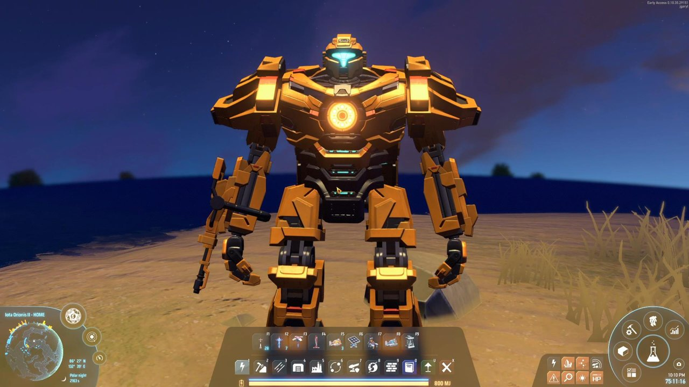
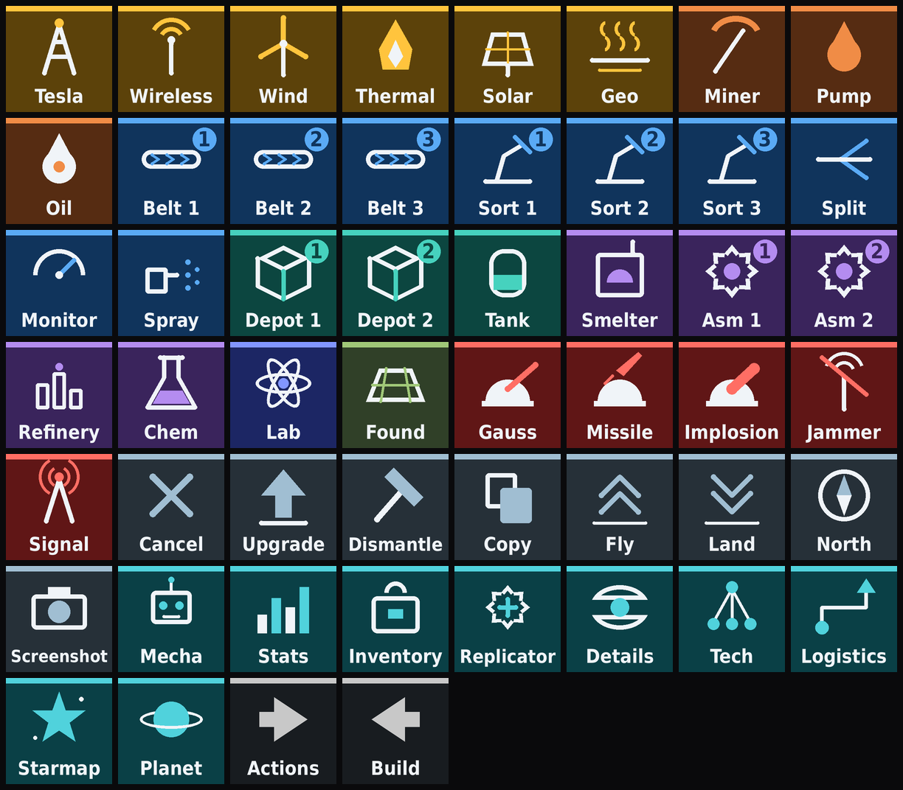

# Dyson Sphere Program: Voice and Stream Deck Control

Build, fly and open panels in Dyson Sphere Program by voice with **VoiceAttack**, or by button
with a **Stream Deck XL**, or both. Say "wind turbine", or press the Wind button, and the build bar
opens on the wind turbine while Icarus answers "Deploying wind turbine".

- **59 commands:** every unlocked building, plus cancel, upgrade, dismantle, copy, fly, land,
  face north, screenshot and the panels. The full list is in
  [`docs/command-map.csv`](docs/command-map.csv).
- **One source:** every command is defined once in [`data/commands.toml`](data/commands.toml).
  The VoiceAttack profiles, Stream Deck profiles, icons and docs are all generated from it.

Tested with VoiceAttack v2.2.0.3 and Stream Deck 7.6.1 on Windows.

## See it in action: voice control

[](https://youtu.be/1gPESxnpP84)

**Hands-free factory building.** Watch Icarus build by voice: say a building's name and the right
build bar and building are selected for you, while Icarus confirms each order. It also covers
flying, landing and opening panels without touching the keyboard.
[Watch on YouTube](https://youtu.be/1gPESxnpP84)

*This repo replaces the archived DysonSphereProgram-VoiceAttack-Profile and
DysonSphereProgram-Stream-Deck-Profile repos. Their full history is included here.*

## What's included

| File | What it does | Needs |
|---|---|---|
| `voiceattack/profiles/DSP Build Hotkeys-Profile.vap` | Voice commands; Icarus replies in an Azure voice | VoiceAttack, plus Azure TTS set up |
| `voiceattack/profiles/DSP Build Hotkeys-LocalVoice-Profile.vap` | Same commands; Icarus uses your Windows voice | VoiceAttack |
| `streamdeck/profiles/DSP Stream Deck XL (VoiceAttack).streamDeckProfile` | Buttons that run the voice commands, so Icarus replies too | Stream Deck XL, VoiceAttack and the HCS connector plugin |
| `streamdeck/profiles/DSP Stream Deck XL.streamDeckProfile` | Buttons that send the keys directly (no Copy button) | Stream Deck XL only |

## Before you start

**For everything:**
- **Windows, and Dyson Sphere Program.** The profiles use DSP's default keys. If you've rebound
  any controls in the game, set the same keys in [`data/keybinds.toml`](data/keybinds.toml) and
  rebuild (see [Custom key bindings](#custom-key-bindings)).

**For voice:**
- **VoiceAttack 2, full version.** The free trial allows one profile with up to 20 commands, and
  this has 59. VoiceAttack is a one-time purchase from voiceattack.com or Steam.
- **A microphone and Windows speech recognition.** Running Windows' speech training helps.
- **For the Azure profile:** an Azure Speech key set up in VoiceAttack. See
  [the voice guide](docs/changing-the-voice.md#one-time-azure-setup).

**For the Stream Deck:**
- **A Stream Deck XL** (8 × 4 keys) and the **Stream Deck app 7.6 or later.**
- **For the VoiceAttack version:** VoiceAttack (above) with a DSP voice profile active, and the
  **HCS Stream Deck Connector** plugin from HCS VoicePacks
  (https://www.hcsvoicepacks.com/products/streamdeck-connector). It's a paid plugin and appears
  in Stream Deck as **VA Streamdeck**.

**To change anything:** Python 3.11+ and Pillow (`pip install -r requirements.txt`).

## Quick start

**VoiceAttack**
1. In VoiceAttack, choose **Import Profile** from the profile actions menu (beside the profile
   name), pick a `.vap` from `voiceattack/profiles`, and switch to it.
2. Recommended: in **Options → Text-to-Speech**, tick **Single TTS Instance**. If you can, send
   Icarus to your headset with **Override Default Text-to-Speech Device**.
3. Keep Dyson Sphere Program as the active window and start talking.

**Stream Deck**
1. Double-click a profile in `streamdeck/profiles`, or import it from the Stream Deck app
   (Preferences → Profiles → Import), and select it on your XL.
2. For the VoiceAttack version, keep VoiceAttack running with the DSP profile active.

**Updating:** delete the old profile in VoiceAttack or Stream Deck before importing the new one.
In VoiceAttack, re-apply any voice or effect-set change with Mass update. See
[the voice guide](docs/changing-the-voice.md).

## How the voice commands read

Square brackets list alternatives separated by `;`, and a trailing `;` makes the group optional:

| Written as | You can say |
|---|---|
| `[build;place;] wind turbine` | "wind turbine", "build wind turbine", "place wind turbine" |
| `[conveyor belt;conveyor;belt] [two;mark two]` | "belt two", "conveyor mark two", "conveyor belt two", … |

Every building also accepts "build" or "place" in front.

## Stream Deck layout

Three pages. The **bottom row is the same on every page**: Cancel, Upgrade, Dismantle, Copy,
Fly, Land, then ◀ Prev and Next ▶. Prev is blank on page 1 and Next on page 3.

| Page | Row 1 | Row 2 | Row 3 |
|---|---|---|---|
| 1 | Power | Accumulator, collecting, storage | Logistics (belts, sorters, splitter, monitor) |
| 2 | Production and COSMO | Transport, spray coater, foundation | Defence |
| 3 | Panels | Planet, North, Screenshot | Free |

Every button is listed in [`docs/layout.md`](docs/layout.md).



The icons are original, drawn by `scripts/icons.py` from basic shapes. Nothing is copied from the
game. Background colour shows the group:

- **Gold:** power
- **Rust:** collecting
- **Blue:** logistics
- **Teal:** storage
- **Purple:** production
- **Indigo:** research
- **Green:** foundation
- **Red:** defence
- **Slate:** actions
- **Cyan:** panels

A number badge marks the tier.

## How it works

**Build commands press two bar keys.** In DSP, pressing a bar's number key when that bar is
already open closes it. So each build command first presses a *different* bar's key, then the one
it wants, then the F-key, and it works whatever is open:

```
"wind turbine":  9 → 0.1 s → 1 → 0.1 s → F4
```

Bar 9 items use `8` as the first key.

**Icarus speaks first,** so his reply doesn't wait for the key presses.

**Replies never match a command.** VoiceAttack can hear Icarus through your speakers. If he
repeated a command, it would run again in a loop, so replies start with "Deploying" or
"Constructing". The build checks this.

**The VoiceAttack Stream Deck buttons** send VoiceAttack a phrase, exactly as if you'd said it.
VoiceAttack does the keys and the reply. The keys version uses Stream Deck's own Hotkey and Multi
Action buttons instead.

**Copy is only in the VoiceAttack version.** Stream Deck's built-in actions can't click the mouse,
and BarRaider SuperMacro didn't work: `{{SHIFT}{LBUTTON}}` was tried with a higher output delay,
and with pauses.

## Custom key bindings

If you've rebound a control in DSP, open [`data/keybinds.toml`](data/keybinds.toml), uncomment its
line and set your key:

```toml
[keys]
land = "L"        # was Alt
slot4 = "F12"     # every building on F4 moves to F12
```

Then run `python scripts/build_all.py` and re-import. Voice commands, both Stream Deck profiles
and the docs all follow it. The build stops if two controls share a key or a key can't be sent.

## Adding or changing a command

1. Edit [`data/commands.toml`](data/commands.toml). The top of the file explains every field. A
   new building looks like this:

   ```toml
   [[building]]
   name = "Plane Smelter"
   bar = 5
   key = "F2"
   phrase = "plane smelter"
   reply = ["Deploying plane smelter", "Constructing plane smelter"]
   deck = { label = "Plane", page = 2, row = 2, col = 7, group = "production", glyph = "furnace", say = "plane smelter" }
   status = "likely"
   ```

   A building that unlocks into a slot listed as `[[slot]]` replaces that entry.
2. Run `python scripts/build_all.py`. It checks the data first and stops if anything is wrong:
   - a reply that matches a command
   - two buttons in the same spot
   - a Stream Deck phrase with no matching command
   
   Then it rebuilds both VoiceAttack profiles, both Stream Deck profiles, the icons and the docs.
3. Re-import the profiles you use, and commit.

Every push runs the **Verify** check on GitHub (Actions tab). It runs the same checks, rebuilds
everything, and fails if a generated file wasn't rebuilt after `commands.toml` changed. Run
`python scripts/verify_build.py` to do the same locally; commit first, because it compares
against the last commit.

A new kind of icon needs a glyph added in `scripts/icons.py`. Run
`python scripts/build_all.py --check` to check the data without building.

## Files

| Path | What it is |
|---|---|
| `data/commands.toml` | Every command, defined once. **Edit this.** |
| `data/keybinds.toml` | Your DSP key bindings, if you've changed any from the defaults |
| `scripts/build_all.py` | Checks the data and builds everything |
| `scripts/dsp.py` | Loads and checks `commands.toml` |
| `scripts/build_voiceattack.py` | Builds the VoiceAttack profiles (voice names are set here) |
| `scripts/build_streamdeck.py` | Builds the Stream Deck profiles |
| `scripts/icons.py` | Draws the button icons |
| `scripts/build_docs.py` | Writes `docs/command-map.csv` and `docs/layout.md` |
| `scripts/verify_build.py` | Checks the committed files match the data (used by the GitHub check) |
| `scripts/fonts/` | Bundled DejaVu fonts for the icons, with their license |
| `.github/workflows/verify.yml` | The GitHub Actions check |
| `voiceattack/profiles/`, `streamdeck/profiles/`, `streamdeck/icons/` | Generated. Don't edit by hand |
| `docs/changing-the-voice.md` | Changing Icarus's voice and effects, and setting up Azure |

## Open items

- Identify the slots still marked **guess** in `data/commands.toml` (bars 5 and 9).
- Add buildings as locked slots unlock.

## License

GPL-3.0, see `LICENSE`.
